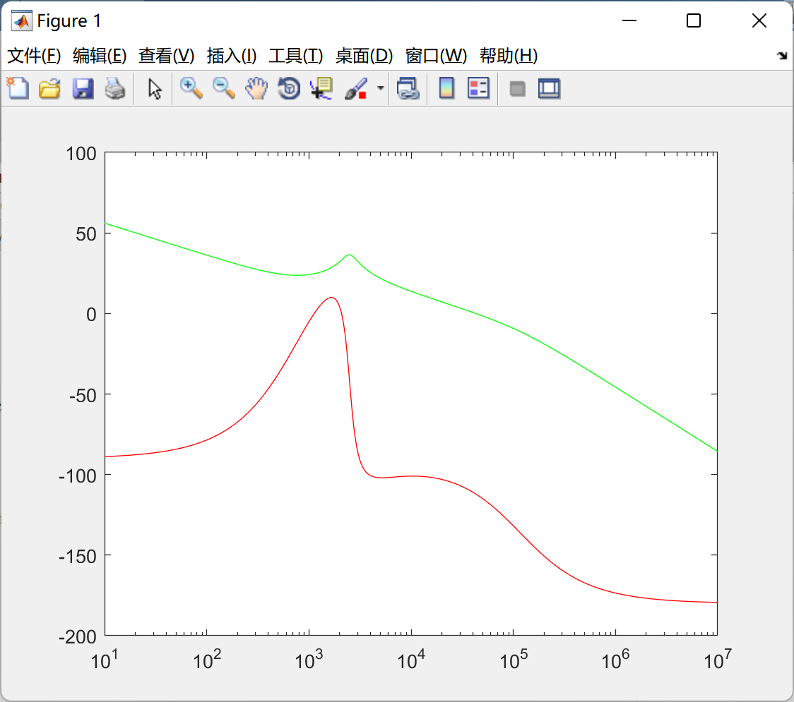

# DC-DC Converter (Matlab Code Implementation)

Under resistive loads, convert a 12S LiPo battery pack to consume currents as low as 5V and up to 500mA.

## Images

<!-- PAYMENT_BLOCK -->

## Get this dataset

- Payment link (Stripe): [Buy now](https://buy.stripe.com/3cs8yP7sY87d0vu9AB)
- Payment QR code: 

<!-- /PAYMENT_BLOCK -->
